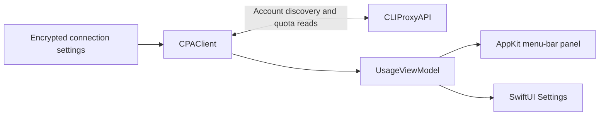

# Usagebar architecture

Usagebar is a native macOS menu-bar client for reading account limits from a user-configured CLIProxyAPI (CPA) instance.

## Components

| Component | Responsibility |
| --- | --- |
| `AppDelegate` | Owns the fixed template status item, panel and Settings window. Routes keyboard shortcuts and updates. |
| `UsagePanelView` | Shows per-provider cards with independent account readings, reset times and connection setup. |
| `SettingsView` | Hosts General, Providers, Connection and About. |
| `UsageViewModel` | Loads the saved connection, reconciles account discovery, and schedules, cancels and publishes refreshes. |
| `CPAClient` | Negotiates CPA management routes, pins quota requests to the account and normalizes provider responses. |
| `CredentialStorage` | Encrypts the configured CPA address and management key locally. |
| `ProviderHTTP` | Shares an ephemeral URL session across overlapping requests and closes it after the last request finishes. |

## Refresh lifecycle

1. On launch, `UsageViewModel` loads the saved CPA configuration independently of any legacy source preference. Without a saved connection, the panel offers a link to Connection settings and schedules no background polls.
2. **Test & Save** authenticates and reads the account list before persisting a new connection. An authenticated empty list is valid. Once a connection is replaced or cleared, in-flight results from the previous connection are discarded.
3. Successful discovery reconciles accounts and retains cached readings for matching identities. Disabled and expired accounts stay visible without quota requests. Eligible accounts under visible providers refresh concurrently. Discovery failures keep cached readings and defer account requests until discovery recovers.
4. The one-shot timer schedules the next due discovery or account refresh. While the panel or Settings is open, the default cadence is two minutes, configurable to 1, 2, 5 or 10 minutes. With both closed, the interval is five times longer. Low Power Mode raises the base interval to at least five minutes. Opening the panel checks for stale data at the visible cadence.
5. Display or system sleep cancels active work and stops timers. Wake checks for stale data. Failures back off up to 30 minutes for local retry delays. Manual refresh bypasses local delays and respects server `Retry-After` deadlines.

UI state is main-actor isolated. `CPAClient`, credential storage and session management share `ProviderActor` away from the UI. Network awaits allow requests to overlap. The session uses no cookie store or response cache and stays open only while requests are in flight.

## Network boundaries

Usagebar uses CPA management endpoints for discovery and account-pinned quota reads. The management API transports quota reads in POST requests. See [CLIProxyAPI setup and boundaries](CPA.md) for routes, provider endpoints and reset inventory behavior. Usagebar has no account control, token refresh or reset redemption actions.

Personal builds open the fork's GitHub Actions page for updates. `AppDelegate.manualUpdatesOnly` gates the release discovery and update execution paths, including any saved automatic-update preference. The bundle prohibits multiple instances.

## Local persistence

| Data | Storage |
| --- | --- |
| CPA base address and management key | `~/Library/Application Support/JustaUsageBar/credentials.enc` |
| Provider visibility, Antigravity pool filters, refresh interval and global shortcut | `UserDefaults` |
| Launch at login | `SMAppService.mainApp` |

The credential file uses AES-256-GCM with the existing Mac hardware UUID-derived key. The decoder reads the saved CPA connection from older files. Legacy provider settings in the encrypted file are ignored on load and omitted the next time the file is saved.

The app runs as `LSUIElement`. Its fixed menu-bar icon and the panel's provider cards are drawn from in-memory state. Account identities, readings and raw responses are held in memory.
